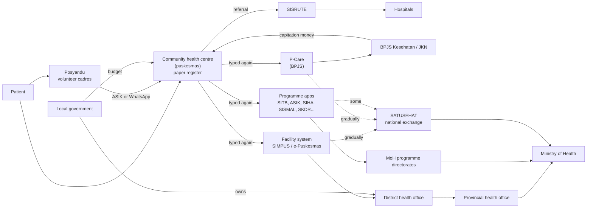

# Indonesia's primary health data ecosystem: map and pain points

*Desk research for the CatatSekali hack. Every figure has a source link or a **verify** tag. This is a one-pass map, not a full literature review.*

> **Corrections after the impact and feasibility review (v3).** These override the text below:
> - **P-Care bridging is one national BPJS web service**, used by any vendor with a cons-ID. It isn't built "district by district". The gap is centres whose system isn't bridged, and paper or offline records.
> - **The money link is precise:** up to 15% of puskesmas capitation depends on KBK indicators computed from P-Care, and up to 10% on the contact rate alone (unique registered members ÷ registered members × 1,000, target ≥150; Peraturan BPJS Kesehatan 7/2019). P-Care doesn't "decide" capitation.
> - **Electronic medical records are mandatory** (Permenkes 24/2022). 34,463 facilities were integrated with SATUSEHAT by Oct 2025 (BKPK Kemenkes, *verify*). Paper persists in outreach, posyandu, maternal and child care, and offline days.
> - **"Up to 6 systems":** say "more than six, in about one centre in five" (22.1% of 850 centres).
> - **ASIK sends data into SATUSEHAT.** We found no route out of SATUSEHAT to ASIK, and no public ASIK API.
> - **Data localisation:** health system data must be stored in Indonesia (PP 28/2024, *verify*), so in-country model hosting is a deployment precondition.
> - The Lamongan, Yogyakarta and "~10 apps" figures couldn't be confirmed by the reviewers. Keep them off slides.

---

## 1. The map

The key thing in the diagram is that **one visit leaves the centre three times**: to the facility system, to the payer (P-Care) and to a programme app. Only one of those three pays the centre.

---

## 2. The five layers

### Governance
- **Ministry of Health (Kemenkes)** runs the six-pillar Health System Transformation: primary care, referral, resilience, financing, workforce, technology ([Kemenkes](https://kemkes.go.id/eng/layanan/indonesian-health-transformation)).
- Its **Digital Transformation Office** runs **SATUSEHAT**, the national exchange on the HL7 FHIR standard ([Kemenkes](https://kemkes.go.id/eng/ministry-of-health-launches-satusehat-platform-to-integrate-national-health-data)).
- Each programme directorate (TB, immunisation, HIV, malaria...) has historically owned its own app.
- **Law 17/2023 (Health Law):** anyone running a health information system must connect it to the national system ([BPK](https://peraturan.bpk.go.id/Details/258028/uuno-17-tahun-2023), [Hukumonline](https://www.hukumonline.com/berita/a/advokat-ini-beberkan-4-poin-penting-uu-kesehatan-bagi-pelaku-usaha-lt65ba0800a5eee)). **Verify:** Constitutional Court review 182/PUU-XXII/2024. Its effect on these articles is unknown.
- **Decentralisation:** districts own the district health offices (Dinkes) and fund the centres. Minimum service standards (SPM) are reported through local government.

### Financing
- **BPJS Kesehatan / JKN:** 282.7m members, 98.6% of the population, at end-2025 ([Bisnis](https://finansial.bisnis.com/read/20260702/215/1985060/bpjs-kesehatan-peserta-jkn-2827-juta-jiwa-beban-pelayanan-kesehatan-capai-rp1913-triliun)). Only ~81% are active members ([Fortune IDN](https://www.fortuneidn.com/news/kepesertaan-aktif-bpjs-kesehatan-lebih-dari-80-pada-akhir-2025-00-ccw2k-7pc3wr)).
- **Capitation:** BPJS pays first-level facilities a monthly amount per registered member, partly linked to performance ([InfoPublik](https://infopublik.id/kategori/nasional-sosial-budaya/930604/ini-bedanya-kapitasi-dan-ina-cbgs-dalam-skema-jkn)). Visits are recorded in **P-Care**. Hospitals are paid per case (INA-CBGs).
- **Donors:** ADB's SEHAT programme, US$350m, results-based, supports primary care, workforce and technology ([Kemenkes](https://kemkes.go.id/eng/sehat-program-supporting-essential-health-actions-and-transformation)).

### Delivery
- Posyandu (volunteer cadres) → auxiliary posts (pustu) → **community health centres** → hospitals.
- **10,268 community health centres** in 2024 ([GoodStats, citing Kemenkes Profil Kesehatan 2024](https://data.goodstats.id/statistic/jumlah-puskesmas-indonesia-2020-2024-TFp0K)).
- Integrated primary care (ILP) is being rolled out across centres, pustu and posyandu ([Kemenkes](https://www.kemkes.go.id/eng/integrasi-pelayanan-kesehatan-primer-memperkuat-peran-kader-kesehatan)). **Verify:** "9,000 centres on ILP" and "156,811 active posyandu" come from a Kemenkes release we didn't open directly.
- **3.94% of centres have no doctor,** rising to 62.57% in Papua Pegunungan ([GoodStats](https://data.goodstats.id/statistic/10-provinsi-dengan-puskesmas-tanpa-dokter-terbanyak-2024-Tcgyw)). There, the reporting falls on nurses and midwives.

### Data systems at one centre

| Role | System | Owner | Why it gets filled |
|---|---|---|---|
| Facility record | SIMPUS / e-Puskesmas / SIKDA Generik | Facility, district | Internal records, district reports |
| Payer | **P-Care** | BPJS Kesehatan | **Capitation depends on it** |
| Programmes | SITB (TB), SIHA (HIV), SISMAL (malaria), ASIK (immunisation, screening, posyandu), SKDR (early warning), SMILE (vaccine logistics) | MoH directorates | Programme targets |
| Referral | SISRUTE | MoH | Referral to hospital |
| National exchange | SATUSEHAT | MoH Digital Transformation Office | Law 17/2023, national strategy |

Sources: [JMIR Med Inform 2025](https://www.ncbi.nlm.nih.gov/pmc/articles/PMC12407222/), [SITB evaluation 2025](https://link.springer.com/article/10.1186/s13690-025-01507-5), [OECD-OPSI on ASIK](https://oecd-opsi.org/?p=39498).

---

## 3. Pain points, ranked by strength of evidence

| # | Pain point | Evidence | Who feels it |
|---|---|---|---|
| 1 | **The same visit is typed several times** | ~30 systems per centre on average, up to 6 per worker for reporting (MoH survey of 2,606 centres, 2022 data, [JMIR 2025](https://medinform.jmir.org/2025/1/e68613)). Facilities enter disease data into ~10 apps, and e-Puskesmas and SITB aren't linked ([SITB evaluation 2025](https://link.springer.com/article/10.1186/s13690-025-01507-5)). Registration staff at a Yogyakarta centre entered every visit in both P-Care and SIMPUS, ~200 patients a day (local study, **verify link**) | Nurse, midwife, registration officer |
| 2 | **Money decides which data counts** | P-Care is tied to capitation, so staff fill it first, and its reports end up inconsistent with the facility system. BPJS answered with local "bridging" modules built district by district (Lamongan study, [UGM](https://jurnal.ugm.ac.id/jisph/article/download/35277/29990), **verify it's the right paper**) | District, ministry: they get two versions of the truth |
| 3 | **The district can't trust or combine what it gets** | No standard data-quality protocols below national level ([WHO 2023](https://www.who.int/indonesia/news/detail/02-11-2023-enhancing-health-data-quality--strengthening-indonesia-s-data-quality-assurance)). Fragmented data blocks tracking of spending at district and facility level ([WHO 2025](https://www.who.int/indonesia/news/detail/29-07-2025-indonesia-strengthens-district-level-data-to-improve-tracking-of-health-financing-and-resource-allocation)). Indicators are tracked redundantly for minimum service standards ([USAID](https://pdf.usaid.gov/pdf_docs/PA00XC31.pdf)) | District health office |
| 4 | **The national pipe exists, but the last mile is still manual** | SATUSEHAT is live, but Kemenkes says recording and reporting are not yet fully digitised and integrated, and it is still simplifying existing apps ([Kemenkes](https://kemkes.go.id/eng/digitalisasi-permudah-akses-layanan-kesehatan-primer)) | Ministry, Digital Transformation Office |
| 5 | **Systems go down** | When P-Care is down, staff postpone entry to the next day (local studies, **verify**) | Registration officer |
| 6 | **The community layer has two channels** | Cadres record in ASIK or through a WhatsApp chatbot, and official sources don't agree which applies ([OECD-OPSI](https://oecd-opsi.org/?p=39498), Kemenkes releases) | Centre staff merging posyandu data |

---

## 4. Where CatatSekali fits

- **The user:** the centre's registration or data officer, often a nurse or midwife, **at the end of each day**.
- **The moment:** re-typing the paper register into the facility system, P-Care and a programme app.
- **The move:** read the register once → each visit becomes one record → route it to every system that needs it → flag where the systems would disagree, **before** the payer's version and the facility's version drift apart.
- **Why the ministry adopts it:** it feeds SATUSEHAT and the existing apps, it doesn't replace them, and Law 17/2023 already requires connection. It replaces the district-by-district P-Care "bridges" with one entry point.
- **Why BPJS cares:** cleaner P-Care data and fewer late entries.

**Not claimed:** that CatatSekali connects to P-Care, SATUSEHAT or any ministry app today. In the prototype, every destination is **simulated** with synthetic data.

---

## 5. Verify with a mentor before it goes on a slide
- The exact P-Care and ASIK field lists, and the name and code of the centre's monthly morbidity report.
- The Lamongan and Yogyakarta (Tegalrejo) study links, and their years.
- The effect of the Constitutional Court review on Law 17/2023's information-system articles.
- The current SATUSEHAT integration count (no 2025 national figure found).
- The ILP and posyandu figures (from Kemenkes releases not opened directly).
