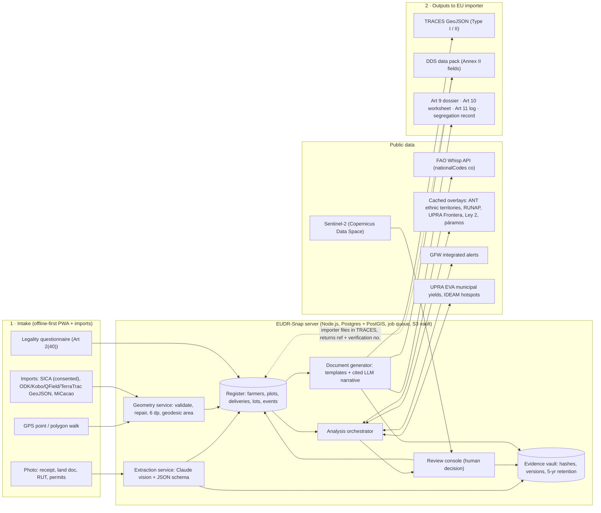
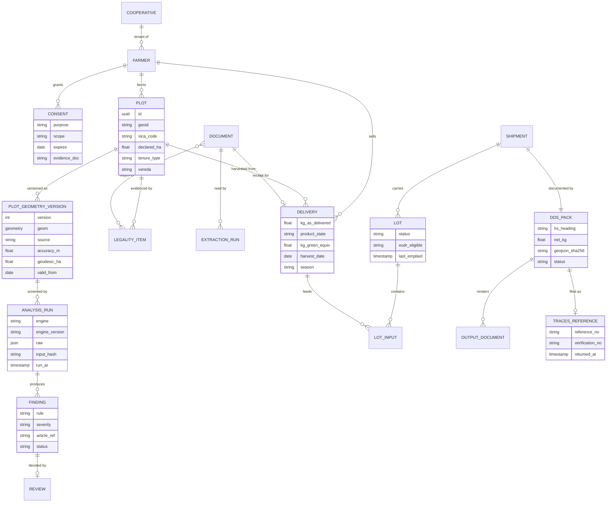
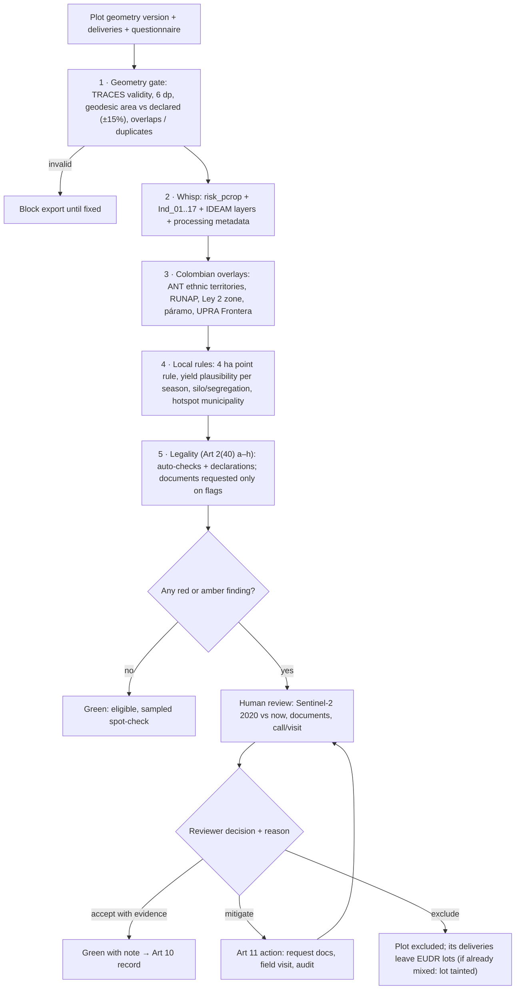

# EUDR-Snap should build the importer's evidence file

EUDR-Snap's architecture should turn a cooperative's paper records, plot locations and public geodata into a **reviewed, evidence-linked due diligence package that an EU importer files**. It should not try to be a filing tool itself. As of November 2026 the legal roles are fixed. Regulation (EU) 2025/2650 leaves the full due diligence statement (DDS) with the upstream operator, which is normally the EU importer. Colombia is **standard risk**, which rules out the simplified declaration, Article 13 simplified due diligence and micro/small primary operator status for Colombian producers. A non-EU cooperative without an EU EORI cannot register as a filing operator in the EU Information System. The architecture that fits has five layers. Four intake channels (Claude vision extraction of paper documents, field GPS capture or import, consented SICA data for coffee, and open Colombian and global geodata) feed one plot-and-lot register. A five-stage analysis pipeline follows: geometry validation, FAO Whisp, Colombian legal overlays, local plausibility rules, then mandatory human review. A document generator then fills the TRACES GeoJSON and DDS fields deterministically, and the LLM drafts only the Article 10 and 11 reasoning, with every claim tied to an evidence ID and signed off by a named person. The research also points to three strategic shifts. Coffee geolocation is already largely covered by the FNC's SICA, so cocoa is the bigger opening. Mass balance is not allowed, so "dropping the red plot" only works if the lot is physically segregated. Global forest maps over-flag shade coffee and cocoa, so a Whisp "high" result should send the plot to review, not reject it automatically. The existing MVP (Whisp proxy, traffic-light `classify()`, 4 ha and yield rules, cached fallback) is the right core. What it lacks is a persistent data model, the legality layer, the review step and the output generators.

## The importer files and the cooperative supplies the evidence

The design depends on who holds the legal duty. Since 2025/2650, the DDS is filed only by the "operator", the first entity to place products on the EU market or export them. Downstream operators and traders now just collect and keep supplier and customer details and the DDS reference number ([Reg. 2025/2650](https://eur-lex.europa.eu/eli/reg/2025/2650/oj/eng); [Green Forum, roles](https://green-forum.ec.europa.eu/nature-and-biodiversity/deforestation-regulation-implementation/roles-and-responsibilities_en)). Colombia appears on neither list in Implementing Regulation 2025/1093, so it is standard risk ([Implementing Reg. 2025/1093](https://eur-lex.europa.eu/legal-content/EN/TXT/HTML/?uri=CELEX:32025R1093)). The new one-off simplified declaration is available only to micro and small primary operators **established in a low-risk country**. Article 13 simplified due diligence applies only when all products come from low-risk countries ([EUDR Art. 13](https://eur-lex.europa.eu/legal-content/EN/TXT/HTML/?uri=CELEX:32023R1115)). The Commission says non-EU smallholders who sell to intermediaries "have no legal obligations under the Regulation" ([FAQ v5, Q3.21](https://transition-pathways.europa.eu/system/files/media/document/2026-08/FAQ-UPDATE-5th-Iteration-EN.pdf)). At the system level, a non-EU operator is validated only with an EORI issued by a Member State or by the UK for Northern Ireland, and non-EU operators can only declare IMPORT ([Validation rules](https://eudr.webcloud.ec.europa.eu/tracesnt/help/eudr-documentation/operator/validation-rules.html)). An authorised representative must be EU-established ([FAQ](https://eudr.webcloud.ec.europa.eu/tracesnt/help/eudr-documentation/operator/faq.html)). **A Colombian cooperative therefore cannot file the DDS. Neither can EUDR-Snap as a non-EU tool.** Both prepare data. The dates still apply to the importer: **30 December 2026** for large and medium operators, **30 June 2027** for micro and small ones ([Reg. 2025/2650](https://eur-lex.europa.eu/eli/reg/2025/2650/oj/eng)). The Commission's May 2026 review declined further legislative changes ([COM(2026) 191](https://environment.ec.europa.eu/document/download/a3c5c3a0-232e-43c4-b0b8-1eecb1df45c7_en?filename=Report+from+the+Commission+to+the+Council+and+Parliament+on+the+EUDR.pdf)).

This puts the product's value in the importer's evidence burden, not in the filing step. Article 9 requires the operator to hold "adequately conclusive and verifiable information" on deforestation-free status and legality, plus harvest dates and supplier and customer contacts, for five years. Articles 10 and 11 require a documented risk assessment against criteria (a)–(n) and documented mitigation, each reviewed at least annually ([EUDR Arts. 9–12](https://eur-lex.europa.eu/legal-content/EN/TXT/HTML/?uri=CELEX:32023R1115)). The Commission provides "no pre-set format" for any of this and says due diligence is "not a 'tick-the-box exercise'" ([FAQ v5, Q5.16](https://transition-pathways.europa.eu/system/files/media/document/2026-08/FAQ-UPDATE-5th-Iteration-EN.pdf)). A cooperative that hands its importer a validated GeoJSON file, a DDS data sheet and a pre-structured, evidence-cited Article 9–11 file removes most of the importer's work. That gives the importer a reason to keep buying from that cooperative.

### What the research changes about the MVP's pitch

Four findings change the product strategy. First, **coffee geolocation is largely solved**. SICA holds georeferenced records on about **1.8 million coffee lots and about 500,000 families**. More than 1,000 FNC technicians are collecting written consent so that registered exporters can access coordinates, and Racafé calls geolocation "largely solved" ([Daily Coffee News, May 2026](https://dailycoffeenews.com/2026/05/12/as-colombia-preps-for-eudr-challenges-for-smallholders-and-indigenous-growers-remain/); [Mongabay, Mar 2026](https://news.mongabay.com/2026/03/colombias-coffee-industry-well-placed-but-wary-as-eu-deforestation-rule-looms/)). For coffee, EUDR-Snap should import SICA geometry and focus on receipts, lot-to-plot linkage and legality evidence. Second, **cocoa is the larger gap**. Its traceability is private (CNCh, Luker) or the open-source MiCacao app, and CGIAR still recommends creating a national cocoa platform and farm registry, which confirms none exists ([CGIAR brief, Jul 2026](https://cgspace.cgiar.org/server/api/core/bitstreams/fa52c0c1-a3bc-4b12-840f-1a47d015ff54/content)). Cocoa departments with recent forest change (Caquetá, Putumayo, Guaviare, Meta) face direct exclusion risk. Third, **mass balance is not allowed**. Chains that mix in commodities of unknown origin "are not allowed", and one post-2020 deforested plot in a mixed bulk lot makes the whole batch non-compliant ([FAQ v5, Q1.4–1.5](https://transition-pathways.europa.eu/system/files/media/document/2026-08/FAQ-UPDATE-5th-Iteration-EN.pdf)). Segregation has to be built into the data model. Fourth, **satellite screening is commoditised and error-prone in agroforestry**. JRC's GFC2020 has an 18% probability of overestimating forest, "significant ... in regions with agroforestry systems like coffee and cocoa" ([ESSD 2026](https://essd.copernicus.org/articles/18/1331/2026/)). In a Mexican test, global maps flagged about three-quarters of 600 long-established coffee plots as non-compliant ([Mongabay, Dec 2025](https://news.mongabay.com/2025/12/researchers-find-concerning-gaps-in-global-maps-used-for-eudr-compliance/)).

The market is also crowded: SICA, exporter systems, Koltiva, TraceX, Rainforest Alliance tools, MiCacao and INATrace ([Mongabay](https://news.mongabay.com/2026/03/colombias-coffee-industry-well-placed-but-wary-as-eu-deforestation-rule-looms/); [Koltiva](https://www.koltiva.com/post/weather-tariffs-and-crop-yields-the-triple-risk-facing-brazil-s-coffee-chain)). EUDR-Snap's defensible position is the part none of them covers well. It takes **paper to reviewed records with LLM intake, legality evidence proportional to risk, and buyer-neutral export of cooperative-owned data**. That matches the GIZ/INCAS cost study's pain points: associations "pierden acceso a polígonos financiados por cooperación", buyers re-validate with different layers, and "software integral" creates lock-in ([INCAS Global+ study](https://www.sustainable-supply-chains.org/fileadmin/INA/Project_Page/INCAS_Global__/Presentacion_Vertical_Cafe.pdf)). The DPI framing has a concrete opening too. At the EU Delegation and EFI "Exportar sin Deforestar" meeting on 30 October 2026, the main challenge named was integrating IDEAM, UPRA, SICA and cocoa records "so EU buyers can consult them" ([IFM Noticias, Nov 2026](https://ifmnoticias.com/economicas/colombia-avanza-en-la-consolidacion-de-sistemas-para-garantizar-exportaciones-libres-de-deforestacion-hacia-europa/)). The Team Europe Initiative on deforestation-free value chains, at about €86M by October 2025, already funded a Huila coffee pilot that geolocated 200 farms and ended in April 2026 ([ICO TW3 presentation](https://www.ico.org/documents/cy2025-26/TW3_EUDR_20260527.pdf)).

### Target architecture at a glance



The MVP already covers the C1 to B4 edge: a server-side Whisp key, `POST /api/risk`, `classify()`, and a cached fallback that is clearly labelled as cached (`C:\Users\User\hackathonpo\eudr-snap\server.js`, `whisp.js`). Everything else on the diagram is new.

## Four intake channels feed one versioned plot-and-lot register

### Paper documents go through Claude vision with structured outputs

The main paper documents in the chain are the cooperative purchase receipt or factura, the Cédula Cafetera, land documents (certificado de tradición y libertad, escritura, or informal proof such as a sana posesión letter or notarised compraventa), and the RUT. No official templates for cooperative receipts were found, so the field lists must be checked against real anonymised samples. The Cédula Cafetera chip carries **17 SICA variables** and is the payment channel at cooperatives ([FNC ABC Cédula Cafetera](https://federaciondecafeteros.org/app/uploads/2025/10/ABC-CC-V14-Oct.pdf)). That makes it a useful join key between a receipt and SICA plots.

Extraction should use Claude structured outputs (`output_config.format` with `type: "json_schema"`), which guarantee schema-valid JSON ([Claude docs](https://platform.claude.com/docs/en/build-with-claude/structured-outputs)). Every field should be a nullable object `{value, confidence, evidence (verbatim text), page, illegible}`, with top-level `document_type`, `language` and `warnings[]`. The prompt rule is absolute: return null when a value is illegible, and never infer coordinates, areas or IDs. Coordinates are a separate case. `transcribed_coordinates` stores whatever the document says verbatim, while `geometry` can only come from GPS, a map or an import, never from the model. Output can be truncated at `max_tokens` even with structured outputs on, so the service must check `stop_reason` ([AWS Bedrock notes](https://docs.aws.amazon.com/bedrock/latest/userguide/structured-output.md)). Deterministic post-checks follow. Units are normalised (quintales, cargas and arrobas to kg, with the factor shown, and pergamino seco converted to green equivalent). Dates are validated. Each `evidence` string must appear in the image's OCR layer. Kg must pass the yield plausibility rule. Names, cédula numbers, quantities and dates are legally material, so they go to a side-by-side human check and require a click to accept. An append-only `extraction_run` row records the image SHA-256, model ID, prompt version, raw JSON, reviewer diff and final values. That review record is what makes the data defensible to a competent authority. No published benchmark of Claude on handwritten Spanish agricultural receipts exists, so the pilot must run an internal evaluation on 30–50 real documents before relying on accuracy.

Under the Digital Public Goods Standard, an AI system's eligibility depends on how open its model, data and code are ([DPGA](https://www.digitalpublicgoods.net/blog/ai-systems-as-dpgs)). The LLM should therefore be a **swappable adapter** (any model with JSON-schema output), and a fully manual entry path should exist so the open core stands without a proprietary API.

### Field geolocation is captured once, validated hard and versioned

For farms not in SICA, which means most cocoa and unaffiliated coffee, the PWA captures a point or a walked polygon. It records per-vertex accuracy, vertex count and walk duration, because device-reported accuracy does not predict real error. Smartphone area errors average **4–7%**, with at least one plot per test off by 10% or more ([Seyyedhasani et al. 2016](https://uknowledge.uky.edu/bae_facpub/16)). The app should also accept GeoJSON from ODK, Kobo, QField, TerraTrac or GeoRoots rather than rebuilding polygon capture ([FOSS4G 2025](https://talks.osgeo.org/foss4g-2025/talk/BXYXV3/); [EFI GeoRoots Editor](https://efi.int/news/georoots-editor-accessible-secure-and-eudr-ready-geodata-editing-directly-your-browser-2026-02)). The geometry service applies the Information System's rules at intake. Coordinates are WGS84 in lon/lat order and truncated to 6 decimals. Polygons must be closed, with no holes and no self-intersection. LineStrings are not accepted. `Area` must be a JSON number, because a quoted `"3"` is read as 0 ([GeoJSON description](https://eudr.webcloud.ec.europa.eu/tracesnt/help/eudr-documentation/operator/geojson-description.html)). The service repairs geometry with PostGIS `ST_MakeValid`, keeping only polygonal parts, and shows the diff for confirmation. It then computes geodesic area. Geometry edits create a new `plot_geometry_version` and never overwrite the old one, because a declaration has to point at the exact geometry it was filed with. GIZ recommends polygons even under 4 ha because they reflect the real cultivated area ([GIZ cocoa ruta](https://www.giz.de/sites/default/files/media/els-document/2026-06/ruta-conformidad-productores-cacao-eudr-compressed_0.pdf)). The app should default to polygons and allow points only where the rule permits.

### SICA and other registries are imported under consent

The FNC position is that exporters carry the compliance burden, and SICA access currently runs through registered exporters with farmer habeas-data consent ([Agronegocios, Aug 2024](https://www.agronegocios.co/agricultura/fnc-lanzara-plataforma-que-dara-acceso-a-coordenadas-de-lotes-cafeteros-3935059)). EUDR-Snap should therefore accept a SICA-derived export, received through the exporter or through the cooperative if FNC agreements allow, mapped onto its own plot table with `source = sica` and the SICA lot code kept. It should not re-collect those geometries. SICA neither produces a DDS nor proves legality ([TraceX](https://tracextech.com/eudr-coffee-compliance-colombia/)), which is where the rest of the pipeline adds value. For cocoa, interoperability with MiCacao and the Fedecacao-led Mesa Nacional de Trazabilidad matters more than any import, so that EUDR-Snap does not become another silo. Plot identity across systems should use **AgStack GeoIDs**, which are anonymous, "addressable but not discoverable" plot identifiers that Whisp already consumes ([AgStack Asset Registry](https://agstack.github.io/agstack-website/asset_registry); [FAO Whisp overview](https://www.fao.org/fileadmin/user_upload/faoweb/NFM/WhispOverview.pdf)). The GeoID, not the farmer's name, becomes the key shared with importers.

### Open geodata is called live or cached as overlays

| Source | What it answers | Access pattern |
|---|---|---|
| FAO **Whisp** (`/api/submit/geojson`, `nationalCodes: ["co"]`) | Forest in 2020, disturbance before and after 2020, commodity presence; `risk_pcrop` for coffee and cocoa | Live API; sync up to 500 geometries in 60 s, async plus polling; 30 req/min, 2 concurrent jobs (MVP README, checked against openapi.json) |
| Whisp Colombia layers `nCO_ideam_forest_2020`, `nCO_ideam_eufo_commission_2020` | Where IDEAM says "not forest" and GFC2020 says "forest", which targets shade-coffee false positives | Returned inside the Whisp result ([layers](https://raw.githubusercontent.com/forestdatapartnership/whisp/main/layers_description.md)) |
| ANT resguardos and consejos comunitarios | Third-party rights and FPIC trigger (Art 2(40)(d), (g)) | ArcGIS Hub FeatureServer, cached nightly ([ANT portal](https://data-agenciadetierras.opendata.arcgis.com/datasets/agenciadetierras::consejos-comunitarios/about)) |
| RUNAP (with WDPA as fallback) | Protected areas | Download or cache; no confirmed public API ([RUNAP docs](https://www.parquesnacionales.gov.co/wp-content/uploads/2026/02/Plan-de-la-Operacion-Estadistica-RUNAP_-2026.pdf)) |
| UPRA **Frontera Agrícola** (Res. 261/2018, amended Res. 327/2025) | Whether agriculture is permitted; 1:100,000, "not for property-level analysis", so a flag only | SIPRA download, cached ([UPRA](https://upra.gov.co:443/en/Documents/01_Frontera_Agricola.pdf)) |
| Ley 2 de 1959 reserve zones (A/B/C), páramos | Forest and environmental status | SIAC layers; availability to verify |
| GFW `gfw_integrated_alerts` | Monitoring after the DDS is filed (GLAD-L, GLAD-S2, RADD, DIST) | Data API with a free key that expires yearly ([GFW](https://www.globalforestwatch.org/blog/data-and-tools/integrated-deforestation-alerts)) |
| Sentinel-2 via Copernicus Data Space | Imagery for human review, 2020 against latest | Process/WMS API; NICFI can no longer be relied on ([GFW blog](https://www.globalforestwatch.org/blog/data-and-tools/planet-imagery-changes-gfw)) |
| UPRA EVA municipal yields | Volume plausibility baseline | Annual dataset ([UPRA EVA 2025](https://upra.gov.co/sites/default/files/2026-02/03_RdosEVA_VF.pdf)) |
| IDEAM annual figures and DTD hotspot bulletins | Subnational risk context | PDFs; DTD 47 (Q2 2026) puts most of the top 25 municipalities in the Andean region ([DTD 47](https://www.lasillavacia.com/wp-content/uploads/2026/10/boletin_dtd_no_47_version_resumida-1.pdf)) |

No free API answers "who legally owns this plot". The SNR certificado de tradición has no API, and the DIAN RUT lookup sits behind a CAPTCHA that the app must not bypass. Tenure and tax evidence therefore come in as uploads or declarations, not automated lookups.

### The data model enforces segregation and freezes what was filed



Three constraints carry the legal weight. First, a `LOT` can be flagged `eudr_eligible` only if every `LOT_INPUT` traces to a delivery from a plot whose current findings are all accepted. There is no "unknown origin" bucket. Second, blended collection-centre lots follow the silo rule: declare every plot that fed the silo since it was last emptied, or for FIFO systems all inputs up to at least 200% of capacity ([FAQ v5, Q1.17](https://transition-pathways.europa.eu/system/files/media/document/2026-08/FAQ-UPDATE-5th-Iteration-EN.pdf)). That is why `LOT.last_emptied` exists. Third, `DDS_PACK` stores the SHA-256 of a frozen GeoJSON snapshot, so later geometry edits cannot silently change what was filed. Only about a quarter of Colombian coffee exports go to Europe ([Mongabay](https://news.mongabay.com/2026/03/colombias-coffee-industry-well-placed-but-wary-as-eu-deforestation-rule-looms/)), so "apto EUDR" and non-EUDR lots must coexist inside the same cooperative. All state changes also go to an append-only, EPCIS-shaped event log (commission, observe, aggregate, ship) with client-generated UUIDv7 IDs, so offline edits merge by appending rather than by overwriting.

## Analysis runs as a five-stage triage that ends with a human



### Whisp is the core engine but never the final word

Whisp is MIT-licensed. It bundles JRC GFC2020, TMF, Hansen GFC, the GLAD/RADD/DIST disturbance layers and the commodity maps, and for Colombia it adds the IDEAM layers when `CO` is passed ([GitHub, forestdatapartnership/whisp](https://github.com/forestdatapartnership/whisp)). Its plain-language rule: **low** means outside mapped forest, or overlapping a commodity map, or disturbed before the end of 2020. **High** means in mapped forest with no commodity overlap and disturbance only after 2020. **more_info_needed** means in forest, with no commodity map and no recorded disturbance ([Open Foris](https://openforis.org/solutions/whisp/)). The MVP's `riskColour()` maps these to red, green and amber, which is correct for the traffic light. The architecture adds four things on top. The review console shows `EUFO_2020` next to `nCO_ideam_forest_2020` and `nCO_ideam_eufo_commission_2020`, so a reviewer can see when "the global map says forest, IDEAM says not forest in 2020". The service reads `whisp_processing_metadata.unavailable_datasets` and `risk_inputs_unavailable` and lowers confidence when layers were missing. It stores the Whisp version and the raw response per run. And every red or more_info_needed coffee or cocoa plot goes to review, not to automatic exclusion. GFC2020 Version 4 may have been released in October 2026 ([EC newsroom](https://ec.europa.eu/newsroom/env/redirection/item/961165)), which means Whisp outputs can shift between runs. That is one more reason to record the engine version.

The MVP README says plots Whisp rates high risk "can be dropped from the shipment". Under the mass-balance rule this holds only before the plot's deliveries enter a blended lot. Once they are mixed, the whole lot is tainted ([FAQ v5, Q1.5](https://transition-pathways.europa.eu/system/files/media/document/2026-08/FAQ-UPDATE-5th-Iteration-EN.pdf)). The pipeline should therefore screen plots **before harvest intake**. A DDS can be filed before harvest only for stable plots ([FAQ v5, Q5.19](https://transition-pathways.europa.eu/system/files/media/document/2026-08/FAQ-UPDATE-5th-Iteration-EN.pdf)), so a green plot status should be in place before the season's purchases begin.

### Local rules catch what satellites cannot see

| Rule | Basis | MVP today | Target behaviour |
|---|---|---|---|
| Point over 4 ha | Art 2(28); TRACES treats Area over 4 ha on a Point as an **error**, and a Point with no Area defaults to 4 ha ([Validation rules](https://eudr.webcloud.ec.europa.eu/tracesnt/help/eudr-documentation/operator/validation-rules.html)) | Amber when `hectares > 4` and geometry is a Point | Amber in the UI **and blocked from export** until a polygon exists; plots of 3.6–4.4 ha go to review because of GPS error; always write a numeric `Area` |
| Yield plausibility | Over-delivery signals laundering from other plots | Fixed caps: coffee 2,500 kg/ha, cocoa 1,500 kg/ha, on a single `volume_kg` | Sum deliveries **per plot per season**, convert pergamino to green (~1.25:1, **verify**), compare with municipal EVA yield ×2 and a hard cap |
| Area mismatch | Declared ha against geodesic ha | None | Flag if outside ±15% |
| Overlap or duplicate | Neighbour disputes, double registration | None | `ST_Intersects`, with intersection/min(area) above 10%, or Hausdorff distance under 5 m |
| Segregation and silo | FAQ Q1.4, 1.5, 1.17 | None | Lot eligibility constraint and silo-since-emptied declaration |
| Subnational risk | Art 10(2)(a), (f) | None | Raise review priority in IDEAM hotspot municipalities (via Whisp `Admin_Level_1` plus a municipality join) |

The yield thresholds need recalibrating. The national coffee average is "above 14 bags per hectare", about **840 kg green/ha** ([USDA FAS via Daily Coffee News](https://dailycoffeenews.com/2025/05/29/colombia-coffee-report-production-decline-predicted-amid-weather-and-regulatory-volatility)). The MVP's 2,500 kg/ha cap is therefore about three times average in green terms and lenient in parchment terms. Cocoa averages about 350–400 kg/ha, but modern plantings reach about 1,500 kg/ha and some farms in Arauca, Meta and Santander exceed 2,000 ([UNAL Agronomía Colombiana](https://revistas.unal.edu.co/index.php/agrocol/article/download/121013/96241/758568)). The MVP's 1,500 kg/ha cocoa cap will raise false alarms on exactly the best-run farms. A municipality-relative baseline with a hard cap (about 2,000 kg/ha for cocoa) avoids both problems. The demo case still works under the new rule: Luis Alberto Cuéllar delivering 5,400 kg from 1.8 ha, or 3,000 kg/ha, is implausible under any baseline.

### Legality checks follow the proportional model

Art 2(40) lists eight categories of "relevant legislation". The July 2026 Commission Guidance narrows them: a law counts only if it affects the legal status of the production area and links to EUDR objectives. If the first examination shows negligible risk, operators "need not collect per-plot legal documents". A title is required only if domestic law requires one to produce and sell ([Guidance C/2026/3896 §6](https://eur-lex.europa.eu/eli/C/2026/3896/oj/eng); [COM(2026) 191 §4.1.3](https://environment.ec.europa.eu/document/download/a3c5c3a0-232e-43c4-b0b8-1eecb1df45c7_en?filename=Report+from+the+Commission+to+the+Council+and+Parliament+on+the+EUDR.pdf)). The EFI's Colombia legality tool notes that "the absence of documentary evidence does not imply illegality" and recommends "light" due diligence for most requirements ([EFI palm tool, Fedepalma](https://fedepalma.org/wp-content/uploads/2026/03/ANO-2026-FINAL-Guia-legalidad-palma-aceite-EUDR_Colombia.pdf)). The legality module is therefore one standard questionnaire plus geospatial auto-checks, with documents requested only when a flag fires. That is also what INCAS recommends: "a standardised legal questionnaire with risk-based document sampling" ([INCAS study](https://www.sustainable-supply-chains.org/fileadmin/INA/Project_Page/INCAS_Global__/Presentacion_Vertical_Cafe.pdf)).

| Art 2(40) | Auto-check | Default evidence | Escalation evidence (on flag) | Red flags |
|---|---|---|---|---|
| (a) Land use rights | UPRA Frontera overlay; URT restitution register | Questionnaire: tenure type (title, adjudication, lease, notarised purchase, predial bill, JAC-witnessed sana posesión) | Photo of the document, extracted by Claude; municipal certificado de uso del suelo in conditioned areas | Restitution overlap; name mismatch with cédula; outside the frontier |
| (b) Environment | RUNAP, páramo, Ramsar, Ley 2 Zone A | Water source declaration (aqueduct bill, CAR concession or VRD registration) | CAR documents | Overlap with a protected area; open CAR sanctions |
| (c) Forest rules | Whisp plus Ley 2 zoning | "No clearing since 2020" declaration | CAR forest harvesting permit | Post-2020 loss with no permit |
| (d) Third-party rights | ANT resguardos and consejos comunitarios | None unless there is an overlap | Membership or community authorisation | Overlap with no authorisation |
| (e) Labour | DANE rural child-labour rate as a regional prior | Family-labour declaration; questions on hired pickers | Contracts, PILA | Informal seasonal labour; no PPE |
| (f) Human rights | None | Zero-tolerance declaration on child and forced labour | School attendance proof, ICBF query | Under-15s working; minors applying agrochemicals |
| (g) FPIC | Same ethnic-territory overlay | Triggered only on overlap or adjacency | Consultation or consent minutes | Expansion into collective land |
| (h) Tax, trade | None (the RUT lookup is CAPTCHA-protected) | RUT upload or self-declaration | Renta return; for the cooperative, DEX and parafiscal paz y salvo | No RUT; unregistered intermediaries |

The status logic follows the research. **Green** means formal title, adjudication or certificate, inside the Frontera Agrícola. **Amber** (accepted with a note) means informal but lawful tenure (sana posesión, a lease, a predial bill), an occupied adjudicable baldío, or Ley 2 Zone B/C, plus a land-use certificate and a check that no forest was cleared after 2020. **Red** (escalate) means Ley 2 Zone A, a park or páramo, an ethnic territory without endorsement, or a restitution claim. Informal tenure is the norm in Colombia, so marking every untitled smallholder red would exclude the very farmers the DPI is meant to protect. The app should not ask about ethnicity as a personal attribute. A plot's overlap with an ethnic territory is a geographic fact and does not need it.

### Human review is the control that makes the output defensible

The review console shows each flagged plot with a Sentinel-2 composite from 2020 next to the latest cloud-free scene. Colombian cloud cover often requires multi-month composites. Alongside the imagery it shows the Whisp indicator breakdown, the overlay hits, the extracted documents next to their images, and the delivery history. The reviewer chooses accept-with-evidence, mitigate or exclude, writes a reason, and the decision is stored with reviewer ID and timestamp. That record feeds criterion (g) of Art 10(2) (the reliability of the information) and the Art 11 log. INCAS's traffic-light triage, with second visits or drones only on alerts, is the right economic model. A Huila pilot found **98% of coffee plots meeting the EUDR criterion** ([IFM Noticias](https://ifmnoticias.com/economicas/colombia-avanza-en-la-consolidacion-de-sistemas-para-garantizar-exportaciones-libres-de-deforestacion-hacia-europa/)), so review effort concentrates on a small tail, plus a random sample of green plots as a quality check. After filing, a weekly GFW alert poll per plot reopens review when a high-confidence post-2020 alert appears inside a declared plot. That supports the annual review duty in Arts 10(4) and 11(3).

## Legal outputs are templates filled from reviewed records

### The output set maps one-to-one onto legal obligations

| Output | Legal hook | Content | Who signs or uses it |
|---|---|---|---|
| **TRACES GeoJSON** (Type I per producer or lot; Type II for multi-producer UI import) | Annex II pt 3; IS GeoJSON spec | FeatureCollection, EPSG:4326, 6 dp, exact-case `ProductionPlace`, `ProducerName`, `ProducerCountry: "CO"`, numeric `Area`; points ≤4 ha, polygons >4 ha | Importer uploads it in TRACES |
| **DDS data pack** (JSON plus a readable sheet) | Annex II pts 1–3, 5–6; DDS V4 model | HS heading (0901 coffee, 1801 cocoa beans), description (≤150 chars), net kg excluding packaging, producers (ISO2 country, name ≤500 chars), base64-ready GeoJSON; fixed pt 5 text and pt 6 signature block left blank and marked "draft for the operator" | Importer's responsible person |
| **Art 9 dossier** per lot | Art 9(1)(a)–(h) | Product, quantity, country, plots, harvest date or season, supplier and customer contacts, deforestation-free evidence (Whisp runs plus review), legality evidence indexed to Art 2(40) | Importer keeps it 5 years; competent authority on request |
| **Art 10 risk assessment worksheet** | Art 10(2)(a)–(n), 10(4) | One row per criterion: evidence checked, finding, rating; overall conclusion; next review date | Importer compliance officer |
| **Art 11 mitigation log** | Art 11(1)(a)–(c), 11(3) | Each action (documents requested, field visit, audit, smallholder support), its result and residual risk | Importer, with cooperative input |
| **Segregation and chain-of-custody record** | FAQ Q1.4–1.17 | Lot to deliveries to plots; silo emptied date; no unknown-origin inputs | Both |
| **Retention index** | Arts 4(3), 9, 12(5) | Every artefact with hash, version, creation date and deletion-eligible date; stored DDS reference and verification numbers | Both |

The DDS field constraints come from the live DDS V4 model: `descriptionOfGoods` up to 150 characters, `netWeight` in kg, `hsHeading` of 2–10 digits, producer `name` up to 500 characters, and `geometryGeojson` base64-encoded ([DDS V4 reference](https://eudr.webcloud.ec.europa.eu/tracesnt/help/eudr-documentation/operator/api/due-diligence-statement-v4.html)). The packer must respect the caps of **1,000 producers per commodity line and 10,000 per DDS** ([Validation rules](https://eudr.webcloud.ec.europa.eu/tracesnt/help/eudr-documentation/operator/validation-rules.html)), which bind before the 25 MB limit does for point-heavy smallholder lots. A DDS also should not cover more than one year ([FAQ v5, Q5.19](https://transition-pathways.europa.eu/system/files/media/document/2026-08/FAQ-UPDATE-5th-Iteration-EN.pdf)). The packer should split large cooperative shipments automatically. Templates built on the 2023 text that "reference an upstream DDS" are outdated, because 2025/2650 deleted Annex II point 4 ([Reg. 2025/2650](https://eur-lex.europa.eu/eli/reg/2025/2650/oj/eng)).

The Art 10 worksheet is where EUDR-Snap earns its place, because the Commission provides no template. Several criteria fill automatically. (a) is standard country risk plus the IDEAM hotspot flag. (b) and (f) come from Whisp and IDEAM. (c), (d) and (e) come from the ANT overlays. (g) is the extraction confidence and review record. (i) and (j) come from the segregation record and the yield rule. (n) covers certifications, which "support" but do not replace the DDS ([IFM Noticias](https://ifmnoticias.com/economicas/colombia-avanza-en-la-consolidacion-de-sistemas-para-garantizar-exportaciones-libres-de-deforestacion-hacia-europa/)). Criterion (h) (corruption, armed conflict, document falsification) needs narrative reasoning and is the one Colombian supply chains will be scrutinised on.

### Generation is template-first, the LLM writes only cited narrative, and a human signs

```mermaid
sequenceDiagram
  participant DB as Reviewed register
  participant T as Template engine
  participant L as LLM drafter (swappable)
  participant V as Citation validator
  participant H as Human signer
  participant Vault as Evidence vault
  DB->>T: Facts (kg, ha, HS, plots, findings, evidence IDs)
  T->>T: Fill all factual fields deterministically
  T->>L: Narrative slots + retrieved EUDR/FAQ/Guidance chunks (version-pinned) + evidence records
  L-->>V: claims[] {text, evidence_ids[], article_refs[]}
  V->>V: Reject any claim whose IDs/articles don't resolve; reject numbers in prose
  V-->>L: Retry rejected claims (bounded) or leave slot for manual text
  V->>H: Draft with highlighted claims + linked evidence
  H->>H: Edit, accept, sign (role: coop manager / importer compliance officer)
  H->>Vault: Final PDF + JSON, SHA-256, template + prompt + model versions
```

The safeguards are needed because legal retrieval-augmented generation still fails often. Stanford RegLab/HAI found that Lexis+ AI and Ask Practical Law AI hallucinated more than **17%** of the time, and Westlaw AI-Assisted Research about **33%** ([Stanford HAI](https://hai.stanford.edu/news/ai-trial-legal-models-hallucinate-1-out-6-or-more-benchmarking-queries); [Magesh et al.](https://arxiv.org/abs/2405.20362)). Four controls follow from that. Numbers (kg, ha, coordinates, dates) are injected from the database and never written by the model. Every narrative claim must carry a resolvable evidence ID or article reference, or the validator rejects it. Retrieval runs over a version-pinned corpus: the consolidated 2023/1115 text as amended by 2025/2650, FAQ v5 and Guidance C/2026/3896. Every output carries a "decision support, not legal advice; the operator remains responsible" notice, which reflects the law: operators remain "legally responsible" even when data comes via cooperatives ([FAQ v5, Q1.10](https://transition-pathways.europa.eu/system/files/media/document/2026-08/FAQ-UPDATE-5th-Iteration-EN.pdf)). Structured outputs and citations may not combine in a single call ([AWS Bedrock](https://docs.aws.amazon.com/bedrock/latest/userguide/claude-messages-structured-outputs.md)), so the claim schema is the citation mechanism and the deterministic validator is the check. If the LLM adapter is off, the templates still render with empty narrative slots for the signer to fill. The DDS text may be in any EU language, but the language of the handling Member State is recommended ([FAQ v5, Q7.19](https://transition-pathways.europa.eu/system/files/media/document/2026-08/FAQ-UPDATE-5th-Iteration-EN.pdf)). The generator should render Spanish for the cooperative and English or the importer's language for the importer from the same claim set.

### Filing stays with the importer; API submission is a later, optional path

The Information System's integration path is **SOAP with WS-Security** (UsernameToken with PasswordDigest), not REST. V4 is the current operator version. A submitted DDS can be amended or withdrawn **only within 72 hours**. V4 also removed API retrieval by reference plus verification number ([Operator API index](https://eudr.webcloud.ec.europa.eu/tracesnt/help/eudr-documentation/operator/index.html); [DDS V4](https://eudr.webcloud.ec.europa.eu/tracesnt/help/eudr-documentation/operator/api/due-diligence-statement-v4.html)). For the pilot, the right path is a file the importer uploads plus a data sheet that maps one-to-one onto `DdsCommodityType` and `DdsProducerType`. That keeps EUDR-Snap out of credential custody and out of the liability chain. After filing, the importer enters the returned reference number (at most 14 characters) and verification number back into EUDR-Snap against the lot. That closes the record and gives the customs broker the C716 code value ([Tulli](https://tulli.fi/en/-/eu-deforestation-regulation-eudr-requires-measures-by-importers-and-exporters-consider-these-things-in-your-customs-declarations)). A later V4 client generated from the WSDL could submit using the importer's own web-service credentials or through an EU-established authorised representative. Both raise custody and mandate questions, so this belongs in the scale phase. The 72-hour window is a reason to validate everything before export. The open-source clients found target V1/V2 or are unfinished, and one is AGPL, which matters for a hosted service ([eudr-api-client](https://app.unpkg.com/eudr-api-client@1.0.21/files/README.md)). Endpoints should be configurable, because Implementing Reg. 2026/1565 removed the TRACES reference and hosting may move ([EUR-Lex 2026/1565](https://eur-lex.europa.eu/eli/reg_impl/2026/1565/oj/eng)).

Retention needs explicit design. Art 9 information is kept five years from placing or export, risk and mitigation documentation five years after the exercise, and the DDS five years from submission ([FAQ v5, Q5.8](https://transition-pathways.europa.eu/system/files/media/document/2026-08/FAQ-UPDATE-5th-Iteration-EN.pdf)). The vault should hold immutable, hashed artefacts with a per-object "eligible for deletion on" date, export-anytime bundles for the cooperative, and a deletion job that runs only after the legal period ends and a human confirms.

## Data protection decides whether cooperatives will trust it

Farmer names, cédula numbers, plot coordinates linked to a person, and photos of land documents are personal data under **Ley 1581 de 2012**. Processing them needs prior, express and informed authorisation, which the FNC already collects at scale as habeas-data permits. International transfers fall under **Art. 26**, which bars transfers to countries without adequate protection unless an exception applies. **SIC Circular Externa 003 de 2025** adopted model contractual clauses for transfers and transmissions, although one analysis notes they do not remove the Art. 26 test ([CMS](https://cms.law/en/int/expert-guides/cms-expert-guide-to-data-protection-and-cyber-security-laws/colombia); [SIC CE 003/2025](https://sedeelectronica.sic.gov.co/sites/default/files/normativa/Circular%20Externa%20003%20de%202025.pdf); [Cuatrecasas](https://www.cuatrecasas.com/resources/circular-698654caf0ce8430094773.pdf)). Decreto 1377/2013, now part of Decreto 1074/2015, separates transfer to another controller from transmission to a processor ([Forvis Mazars](https://www.forvismazars.com/co/en/who-we-are/news-publications-and-media/our-news-and-publications/tax-and-legal-news/superintendence-of-industry-and-commerce)). The natural set-up, to be confirmed with counsel, has the **cooperative as responsable (controller), EUDR-Snap as encargado (processor) under a written agreement, and the EU importer as a GDPR controller** for whatever it receives, with a legal-obligation basis for the five-year EUDR retention.

The architecture has to support that set-up. Each cooperative is its own tenant. Consent records are captured in plain Spanish, stating purpose, recipients, retention and rights, and are linked to each farmer and each importer share. Importer sharing is scoped by consent (which lots, which GeoIDs, which fields, until when). Only what the DDS needs leaves the tenant: the geometry, the GeoID and `ProducerName`. The FAQ confirms that no farmer personal data is required unless farmers are direct suppliers ([FAQ v5, Q1.10](https://transition-pathways.europa.eu/system/files/media/document/2026-08/FAQ-UPDATE-5th-Iteration-EN.pdf)), so the default DDS pack can name the cooperative as producer group where the importer accepts that (**verify** against TRACES producer rules). On the EU side, Implementing Reg. 2026/1565 caps retention of personal data in the Information System at five years ([EUR-Lex 2026/1565](https://eur-lex.europa.eu/eli/reg_impl/2026/1565/oj/eng)). Hosting should be in the EU with EU-based LLM processing where available, and photos should be compressed and stripped of EXIF location before upload. The INCAS complaint about associations losing donor-funded polygons, and farmers fearing misuse ([INCAS study](https://www.sustainable-supply-chains.org/fileadmin/INA/Project_Page/INCAS_Global__/Presentacion_Vertical_Cafe.pdf)), is best answered with a one-click full export in open formats (GeoJSON, CSV, PDF), written into the terms of service.

For the DPI claim, the project must meet all nine Digital Public Goods Standard indicators, including the privacy and do-no-harm indicators strengthened in September 2025 ([DPG Standard](https://digitalpublicgoods.net/standard); [DPGA privacy framework](https://www.digitalpublicgoods.net/blog/privacy-and-data-security-framework-for-dpg-standard)). Apache-2.0 or EUPL-1.2 for code and CC-BY-4.0 for templates fit the AgStack and EU ecosystems. Reusing INATrace's MPL-2.0 data model is compatible, because MPL copyleft applies at file level ([agstack/inatrace-backend](https://github.com/agstack/inatrace-backend)). Lot-origin proofs can later travel as **W3C Verifiable Credentials 2.0**, a W3C Recommendation since 2025, following UN/CEFACT UNTP patterns ([W3C](https://www.w3.org/press-releases/2025/verifiable-credentials-2-0)). That would give importers a signed claim instead of database access.

## Build in three phases, from hackathon demo to cooperative scale

| Phase | Window | Build | Exit test |
|---|---|---|---|
| **0 · Hackathon demo** | 21–22 Nov 2026 | Keep the Whisp proxy and cache. Add a receipt-photo → Claude JSON-schema extraction → farmer/delivery record, with a confidence badge and a click-to-accept step. Relabel red as "needs review" with IDEAM-versus-GFC side by side. Add TRACES-valid GeoJSON export (6 dp, numeric `Area`, exact-case properties, 4 ha block) and a DDS data-pack JSON. Add an Art 10 worksheet draft where each line cites an evidence ID. | The jury sees paper → plot → Whisp → GeoJSON a TRACES ACCEPTANCE upload would accept, plus one cited risk paragraph |
| **1 · Pilot** | Dec 2026 – Jun 2027, aligned with the 30 Dec 2026 and 30 Jun 2027 dates | Postgres/PostGIS register and event log; tenants, consent and processor agreement; PWA with offline outbox; SICA import (coffee cooperative) and field capture (cocoa cooperative); cached ANT, RUNAP, UPRA and Ley 2 overlays; legality questionnaire; segregation and silo logic; review console with Sentinel-2; template plus cited-LLM generator with sign-off; evidence vault with retention dates; GeoJSON tested against TRACES ACCEPTANCE; Claude evaluated on 30–50 real receipts; yield rule moved to EVA baselines | One EU importer accepts a full pack for a real shipment; reviewer time per flagged plot measured; zero TRACES GeoJSON rejections |
| **2 · Scale** | H2 2027 onward | GFW alert monitoring; AgStack GeoIDs; Verifiable Credentials for lot origin; MiCacao/MNTC interoperability; optional DDS V4 SOAP client via importer credentials or an EU representative; annual-review automation; DPG registration; HS 2101 11 soluble coffee (in scope from 30 Dec 2027 ([eudrcheck](https://eudrcheck.co.uk/guides/eudr-annex-i-changes-2026-2102))); reuse of the farmer register for organic group-certification ICS | Several cooperatives in production; funding through TEI, EFI or GIZ channels |

The cost profile suits donor funding. Compute is small: a few VMs and a managed PostGIS database, with LLM extraction costing on the order of cents per document (both are assumptions to price before any budget is submitted; see [Claude pricing](https://platform.claude.com/docs/en/about-claude/pricing)). The real cost is onboarding and field support. INCAS found that EUDR costs fall "de manera asimétrica en asociaciones y pequeños productores", with field technicians for coordinates and traceability software among the largest items. Its per-producer figures are presumably in COP, which should be verified ([INCAS study](https://www.sustainable-supply-chains.org/fileadmin/INA/Project_Page/INCAS_Global__/Presentacion_Vertical_Cafe.pdf)). A free tool that removes the software line and cuts technician time through receipt capture and triage addresses the biggest cost items directly.

## Open questions to verify before the pilot

| Question | Why it matters | How to verify |
|---|---|---|
| Can cooperatives (not only registered exporters) access SICA coordinates, and on what terms? What consent rate was reached? | Decides whether coffee intake is import or re-capture | Ask the FNC and a pilot cooperative; the FNC site was unreachable during research |
| Does SICA store polygons or points for most lots? | 4 ha rule compliance for coffee | FNC or exporter sample export |
| Is GeometryCollection accepted, and is a Point nested `[lon,lat]` or `[[lon,lat]]`? | Export validity | Upload test files to TRACES ACCEPTANCE |
| Can a DDS name a producer group instead of each farmer? | Data minimisation | TRACES validation rules plus an importer's competent authority |
| How does a third-party service get an `OperatorAccessIdentifier`, and does API access still need an email request? | Phase 2 API path | Operator API docs, sante-traces@ec.europa.eu |
| Has the 2026 benchmarking review changed Colombia's status? | Low risk would open SD and Art 13 | EUR-Lex before launch; Colombia has requested reclassification ([Portafolio](https://www.portafolio.co/economia/agro/colombia-avanza-para-responder-a-reglas-de-la-union-europea-sobre-productos-libres-de-deforestacion-gobierno-489284)) |
| Is the Commission's producer-country legislation repository live, and has Colombia submitted? | Could replace the EFI mapping as the Art 2(40) reference | Commission IS page, December 2026 |
| What does the Cenicafé coffee legality tool rate? | The palm tool's tenure ratings should not be copied to coffee | Obtain the PDF (connection refused during research) |
| Which GFC2020 version does Whisp's `EUFO_2020` use, and is V4 out? | Reproducibility of risk results | Whisp changelog, JRC Observatory |
| Is `nationalCodes` case-sensitive, and what are the async limits under load? | Batch jobs for cooperatives with thousands of plots | Whisp openapi.json and a load test (MVP verified the field name on 21 Nov 2026) |
| RUNAP, Ley 2 and páramo layer endpoints and licences; ANT data licence | Overlay availability | SIAC and RUNAP portals, datos.gov.co |
| Pergamino-to-green conversion factor and EVA dataset IDs | Yield rule calibration | FNC and UPRA |
| Is Colombia-to-EU transfer adequate under SIC rules (CE 005/2017 list)? Do RNBD registration thresholds apply? | Ley 1581 compliance | Colombian data-protection counsel |
| How does the DPGA assess a proprietary LLM API dependency? | DPG eligibility | DPGA submission review |
| Accuracy of Claude on handwritten Spanish receipts | Review workload and trust | Internal evaluation on 30–50 real documents |
| Do Ley 2 Zones B/C allow coffee or cocoa without sustracción? | Amber or red classification | MinAmbiente, Res. 1527/2012 |

## Conclusion

The research moves EUDR-Snap away from "a compliance app for cooperatives" and toward **the evidence layer an EU importer needs and a Colombian cooperative can supply**. The cooperative has no filing duty and cannot file. The importer cannot place coffee or cocoa without information it can only get from upstream: the FAQ says that if information cannot be obtained, the operator "must refrain" from placing the product ([FAQ v5, Q1.27](https://transition-pathways.europa.eu/system/files/media/document/2026-08/FAQ-UPDATE-5th-Iteration-EN.pdf)). The cooperative's leverage, and the case for public funding, rests on that dependency. The Whisp call that makes the current demo convincing is the most commoditised part of the stack. The parts nobody yet does well for free are capturing receipts into lot-to-plot links, proportional legality evidence, enforcing segregation, and producing cited Art 10 and 11 documents a human signs. Those make up most of the build.

Two choices determine whether this is real public infrastructure or one more silo. On data, the cooperative owns it, shares it by consent and GeoID, and can export everything at any time. On the AI, the LLM is an optional adapter that drafts and transcribes but never sets a number, a coordinate or a verdict. With those constraints, a cocoa-first pilot fills the gap CGIAR describes, a coffee pilot built on SICA shows interoperability instead of duplication, and the same register can later serve organic group certification and the soluble-coffee scope expansion in December 2027.
